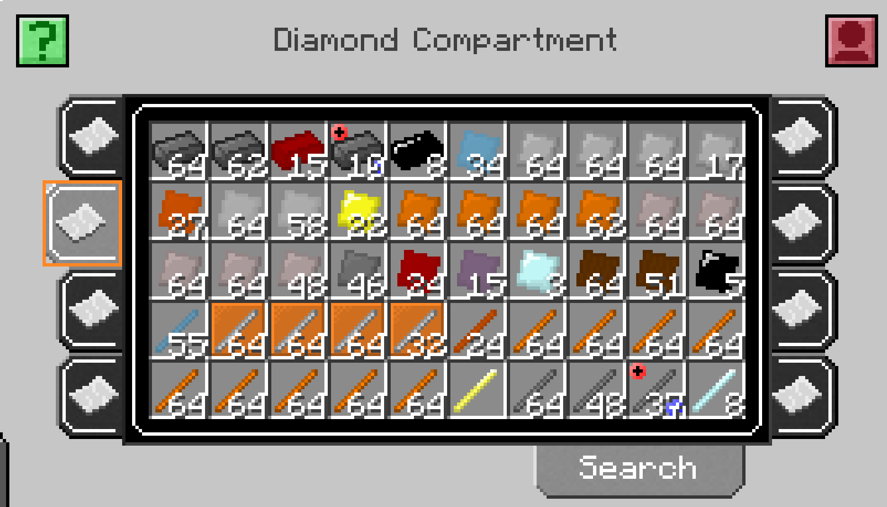

# Compartment Sorting

A small client + server add-on for [GT New Horizons](https://www.gtnewhorizons.com/) 2.9 (Minecraft 1.7.10) that makes
Binnie's **Compartment** (Extra Trees/Binnie Core storage) work better with the pack's inventory tools.

- **Sorting:** Bogosorter's in-GUI sort key (middle click by default) sorts a compartment from its own window. All tabs
  are sorted together, so equal items from different tabs are merged and fill tab 1 first, then tab 2, ...
- **Shift-click into any tab:** shift-click (and shift-drag) from your inventory no longer stops when the open tab is
  full. Items first top up matching stacks in any tab (open tab first), then go into the first empty slot (open tab
  first, then tabs 1, 2, 3, ...).
- **Find It highlighting:** Find It's item search (key T) now highlights the matching slots inside a compartment, and
  outlines the tabs that hold them.

Needs Bogosorter and Binnie Core (both in GTNH). Find It is optional.

> [!CAUTION]
> A hobby project tested by one person in one GTNH 2.9.0 world. Back up your world before trying it.

## How it works

- `CompartmentCompat` registers a Bogosorter slot group covering every tab. `ClientHooks` tells Bogosorter which slot
  is under the mouse, because Binnie's GUI never fills in the vanilla hovered-slot field.
- `WindowCompartmentMixin` widens Binnie's shift-click target list (`WindowCompartment.alterRequest`, normally the open
  tab only) to every tab. The transfer itself is still Binnie's.
- `ControlSlotMixin` / `ControlTabMixin` draw Find It's highlight from Binnie's own slot/tab rendering, since Find It
  draws through an NEI hook that Binnie's GUI never calls.

## Building

Bogosorter and ModularUI2 aren't on the GTNH maven: copy `bogosorter-1.3.55-GTNH.jar` and
`modularui2-2.3.94-1.7.10.jar` from the GTNH 2.9.0 `mods` folder into `libs/`. Then `./gradlew build`. The version comes
from the git tag.
